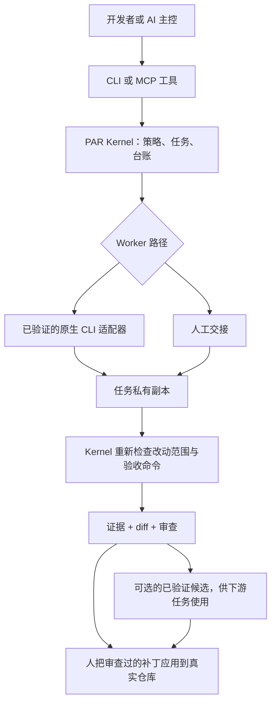

# Personal Agent Runtime（PAR）

### **你的 Agent，你的工作流，不必属于同一家厂商。**

**把手里的 AI 编程工具真正组织起来。任务可以换人做，进度和证据不必从头来。**

PAR 是一个开源、本地运行的 **跨 AI 工具协作 Runtime**。你可以通过**原生 CLI 执行、MCP 主控接入、结构化人工交接**，让不同厂商、不同界面的 AI 工具参与同一条工作流。任务状态、权限、工作副本与验收证据由 PAR Kernel 统一管理，不绑定在某段聊天记录里。

**别只想着换模型。让不同 Agent 工具真正协作。**

[English](README.md) | 简体中文 · [快速上手](docs/QUICKSTART.md) · [人工交接](docs/HANDOFF.md) · [兼容性证据](docs/COMPATIBILITY.md)

[](LICENSE)
[](pyproject.toml)
[-success.svg)](docs/en/COMPATIBILITY.md)
[](https://github.com/Sweetienite/personal-agent-runtime/actions/workflows/tests.yml)

> **当前版本：`1.1.1`**（[`v1.1.1`](https://github.com/Sweetienite/personal-agent-runtime/releases/tag/v1.1.1)，2026-11-10）。**协作工作流不绑定厂商，不等于所有工具都已自动适配。** 目前正式验证的自动 Worker 只有 Codex；WorkBuddy 验证的是**人工交接**；其他工具按 MCP 或人工交接条件参与。macOS 为已验证宿主，详见[兼容性与实测证据](docs/COMPATIBILITY.md)。

## 同一个项目，调动你已经拥有的 AI 工具

想象一个很实际的组合：

```text
你 → Codex（主控）：「分析任务、制定修改范围和验收标准」
          │
          ▼
        PAR：任务合同 + 隔离工作副本 + 持久状态
          │
          ▼
        WorkBuddy（人工交接 Worker）：使用已有额度修改代码
          │
          ▼
        PAR：导入结果 → 检查 Diff → 独立重新运行测试
          │
          ▼
        你：查看证据，决定是否将补丁应用到真实仓库
```

这是一条**可以理解、可以实际操作的跨工具工作流**。它不表示 PAR 能远程自动操控 WorkBuddy：你仍需打开导出的工作目录、将结果交回 PAR。对于已经完成正式验证的原生 CLI Worker，则可以由 PAR 自动启动和收集运行结果。

### **把已有的额度，用在合适的任务上**

你可能早就拥有多个 AI 编程工具：有的附带每日额度，有的会员包含积分，有的模型更便宜，有的适合承担困难决策。

没必要让最昂贵的主控模型包办每一个简单修改。**让擅长决策的 Agent 做决策，让其他工具在你已经合法拥有的额度范围内完成适合它们的工作，再由 PAR 独立验收。**

这不是绕过厂商限制的捷径：**额度是否可用、任务是否计费、是否允许自动化使用，都以各家实际规则为准**。PAR 不绕过限流、不规避付费、不保证省钱，也不会给没有程序化接口的 App 凭空变出自动调用能力。

### **理论上兼容几乎任何 Agent，具体靠的是交接协议，而不是宣传 Logo**

PAR 的**人工交接路径不预设厂商白名单**。理论上，只要一个工具能接收任务，并且让你带回**修改后的工作目录或有效补丁**，它就能有条件地参与代码任务。只能返回文字的网页或手机 AI，也可以参与不需要修改文件的分析任务。

所以，这里提到 Codex、WorkBuddy、TRAE、Cursor 等名字，**只是例子，不是兼容范围的上限**。但要分清：能人工交接 ≠ 已验证该品牌 ≠ 支持原生自动执行；MCP 连接的是主控，不会自动把任意 MCP 客户端变成 Worker。具体支持状态请查看[接入说明](docs/HANDOFF.md)和[兼容性矩阵](docs/COMPATIBILITY.md)。

## 为什么需要 PAR

- **连接 Agent 工具，而不仅是切换模型 API。** 原生 CLI、桌面编码 Agent、人工交接工具可以参与同一套任务合同与结果协议，不要求它们属于同一家厂商。
- **Agent 可以换，已完成的工作不会轻易丢。** SQLite 台账保存任务、审批、尝试、Diff、结果及交接状态，不依赖某一段聊天历史。
- **Worker 说完成了，不等于完成了。** Kernel 在私有工作副本里亲自运行 `acceptance.checks`；模型的「测试通过」自述不是证据。没有检查的写任务不能由自动主控直接验收。
- **给主控足够能力，但留下清晰边界。** 合同限制允许路径，审批、主控租约和只增事件让每一次重要动作可审计。
- **成果可以接力和整合。** 已验收补丁可以汇入候选基线再复检，供有依赖关系的下游任务使用。PAR 不会悄悄改动你的真实项目。
- **小而本地化。** Python 标准库实现，提供 CLI 与 21 个工具的 MCP 主控桥；运行 PAR 本身不需要另买一个模型订阅或注册 PAR 云端账号。

**PAR 不打算重新发明 IDE，也不承诺一个「自动掌控所有 AI」的魔法按钮。** 它专注解决一件事：让独立工具之间的任务、状态和可核验结果能够延续。

## 60 秒概念图



MCP 只表示**主控接入**，不会把任意 MCP 服务变成 Worker。`人应用补丁` 永远是用户的动作；PAR 没有任何自动写入真实项目的路径。

## 选择接入方式

| 路径 | 是什么 | 谁干活 | 证据状态 |
|---|---|---|---|
| **原生 Worker** | 内置适配器非交互启动 CLI Agent 并解析结构化事件。 | Codex CLI（限定版本/OS/账号）；Antigravity 为实验性、默认禁用。 | 仅 Codex 为 `VERIFIED_AUTO` |
| **协议主控** | 支持 MCP 的客户端通过 stdio 调用 PAR 的 21 个工具。 | 你平时对话的客户端。 | Claude Desktop 与 Codex 在 2026-10-16 的只读样本为 `VERIFIED_COORDINATOR`；其他客户端未验证 |
| **人工交接** | PAR 导出私有 workspace 与 `PROMPT.md`，人用 GUI/网页/手机工具完成并导入。 | 你与外部工具。 | WorkBuddy 2026-11-07 为 `VERIFIED_MANUAL`；其他品牌是条件性通用路径 |

也可以完全在终端里由人担任主控。下面的演示不需要任何 AI 账号。

## 几分钟内试一遍（零账号）

```bash
git clone https://github.com/Sweetienite/personal-agent-runtime.git
cd personal-agent-runtime
python3 -m venv .venv && .venv/bin/pip install -e .
export PAR_DATA_DIR="$(mktemp -d)"          # 让演示远离任何已有 PAR 数据
.venv/bin/par init
.venv/bin/par doctor                        # 期望全部 PASS，所有 Provider disabled
.venv/bin/python -B tests/tools/smoke_codex.py --self-test
```

烟测脚本用**真实适配器代码 + 假的 `codex` 程序 + 一次性夹具项目**跑完 submit → approve → run → Kernel 复核 → accept 全流程；不调用模型、不需要登录、不碰真实项目。Antigravity 版本为 `tests/tools/smoke_agy.py --self-test`。两个脚本都不能替代真实 Provider 验证。

第一次命令前设置 `PAR_DATA_DIR` 就能隔离运行；不设置时 `par doctor` 会读取你真实的数据目录。清理：`rm -rf "$PAR_DATA_DIR"`，再删除 checkout。

## 第一个安全任务（配置好 Worker 之后）

这一节假设已有可用的 profile 与 worker。想完全零账号走 `manual_handoff` 的「导出 → 人工作业 → 导入」路径，请按 [docs/QUICKSTART.md §3](docs/QUICKSTART.md#3-零账号的完整人工交接不需要-provider) 操作，并用 `par task handoff` 代替 `par task run`。

用一个小型、可丢弃的 Git 仓库（或 `par fixture create`），不要用含敏感文件的项目：

```bash
.venv/bin/par fixture create demo            # 一次性可写夹具项目，含一个故意 bug
.venv/bin/par project list
.venv/bin/par project show demo               # 项目事实、写入就绪、Context Manifest

cat > draft.json <<'JSON'
{
  "project_id": "demo",
  "title": "Fix add()",
  "description": "Make add() return the sum of its two arguments.",
  "risk": "R2",
  "allowed_paths": ["app/"],
  "acceptance": {
    "criteria": ["the fixture's unit test passes"],
    "checks": [{"name": "unit", "argv": ["python3", "-m", "unittest", "-q"], "timeout": 60}]
  }
}
JSON
.venv/bin/par task draft --draft draft.json > draft.out
tail -1 draft.out > task.json                 # 编译器先打印提示，最后一行是合同
.venv/bin/par task submit --contract task.json
```

写任务会停在 `PERMISSION_WAIT`。批准待决项、运行一次、查看结果与补丁：

```bash
.venv/bin/par task status demo-0001
.venv/bin/par task approve demo-0001
.venv/bin/par task run demo-0001
.venv/bin/par task result demo-0001
.venv/bin/par task diff demo-0001
.venv/bin/par task accept demo-0001          # 只记录验收，不应用任何东西
```

Kernel 在私有副本里运行任务的 `acceptance.checks`。检查通过后 `REVIEW_REQUIRED` 才会变成 `ACCEPTED`；主控验收还受 `approval_mode` 与租约约束。真实仓库保持不变，应用补丁是你另行执行的 `git apply`。

包含普通 Git 仓库与人工交接的完整陌生环境演练见 [docs/QUICKSTART.md](docs/QUICKSTART.md)。

## Kernel 实际保证什么

- 每次尝试使用独立私有副本；Kernel 从不在 Worker 自己的 `.git` 里运行 git。
- 一套显式状态机，数据库触发器再强制一遍；事件只增不改。
- 路径策略：`allowed_paths`、受保护名字（`.git/`、`.ai/`、`AGENTS.md`、`CLAUDE.md`、疑似凭据路径）、符号链接与穿越检查。
- 逐项审批，每项必须写原因，台账记录决定模式、主控与 grant。
- 主控租约：`par coordinator use` 之后，旧桥不能再决策、启动、继续、重试、构建候选或 rebase。
- 可恢复证据：attempt、检查日志、补丁、diff 与崩溃恢复路径。
- 候选整合：已验收 R2 补丁打到一条干净基线并在那里复检；下游任务可使用 `VERIFIED` 候选。
- 带 marker/base/workspace 核对的人工交接；过期、伪造或错误目录的导入会被点名拒绝。

默认 profile 的 `approval_mode` 是 `coordinator_autonomous`：主控可以在当前租约内决定。改为 `coordinator_scoped` 或 `human_only` 可以收回或限定这项权力。`par init` 会在首次使用时打印这条提示。

## 兼容性与限制

广泛的互操作性来自原生、协议与人工三条工作流，并配有按接入方式区分的自动化与验证等级——而不是来自「所有工具/所有 OS 都已支持」的宣称。

**AI 工具（与宿主 OS 分开）。**

| 工具/类别 | 原生 Worker | MCP 主控 | 人工交接 | 状态 |
|---|---|---|---|---|
| Codex CLI | 是 | 是 | — | `VERIFIED_AUTO`（`codex-cli 0.166.0-alpha.6`，macOS，ChatGPT 登录） |
| Claude Desktop | 否 | 是 | — | `VERIFIED_COORDINATOR`（2026-10-16 只读 `list_tasks` 样本） |
| Antigravity（`agy`） | 有代码 | 否 | — | `EXPERIMENTAL`，默认禁用，厂商条款禁止第三方封装 |
| WorkBuddy | 否 | 否 | 是 | `VERIFIED_MANUAL`（5.9.3，macOS，2026-11-07） |
| TRAE / Cursor / Windsurf / Cline / Aider | 否 | 否 | 条件性 | `GENERIC_MANUAL`，未验证 |
| 网页/手机聊天 | 否 | 否 | 仅文本 | `GENERIC_TEXT`，仅 R0/R1 |
| 其他 MCP 客户端 | 否 | 协议可接入 | — | `GENERIC_MCP`，未按品牌验证 |
| ACP | 否 | 否 | — | `RESEARCH_ONLY` |

**宿主 OS。**

| 宿主 | 安装 | CLI 核心 | 假执行烟测 | 真实 Provider | 取消/超时 |
|---|---|---|---|---|---|
| macOS 15.6.1 arm64 | 已验证 | 已验证 | 已验证 | Codex 已验证 | 已验证 |
| Linux（`ubuntu-latest` CI） | CI 安装 | 核心实验级 | 未运行 | 不支持 | CI 作业 `linux_process_control` |
| Windows WSL2 | 未测试 | 未测试 | 未运行 | 未运行 | 未测试 |
| Windows 原生 | `NOT_SUPPORTED` | 静态缺口 | 未运行 | 不支持 | 不支持 |

PAR **不是操作系统沙箱**。私有副本限制 Worker 能改哪里，不限制它能读什么；Worker 与检查命令以你的用户身份运行，具体读盘和联网行为取决于 Provider。不要在未加固环境运行不可信仓库自带的检查命令。`human_only` 是 PAR 协议内的授权约束，不是不可伪造的人类身份鉴别：任何拿到你 shell 权限的进程都能直接调用 CLI。

逐项证据与日期见 [docs/COMPATIBILITY.md](docs/COMPATIBILITY.md)；机器可读事实源为 [docs/product-capabilities.json](docs/product-capabilities.json)。

## 文档

| 入口 | 内容 |
|---|---|
| [docs/QUICKSTART.md](docs/QUICKSTART.md) | **陌生人首次安装**：隔离数据目录、零账号烟测、普通 Git 仓库、人工交接、清理 |
| [docs/USER_GUIDE.md](docs/USER_GUIDE.md) | 每天怎么用：审批、结果、候选、重试、失败恢复 |
| [docs/MODES.md](docs/MODES.md) | 主控/Worker/接口三种角色与状态词汇 |
| [docs/HANDOFF.md](docs/HANDOFF.md) | 接力、人工交接、主控交接 |
| [docs/MCP.md](docs/MCP.md) | MCP 桥：21 个工具、租约与动作策略、永远不能做什么 |
| [docs/KERNEL.md](docs/KERNEL.md) | 状态机、任务合同、台账、一次运行的完整流程 |
| [docs/SECURITY.md](docs/SECURITY.md) | 威胁模型、审批模式、租约、检查执行与隐私边界 |
| [docs/COMPATIBILITY.md](docs/COMPATIBILITY.md) | 兼容性证据矩阵与未测项 |
| [docs/INDEX.zh-CN.md](docs/INDEX.zh-CN.md) | 全部中文文档索引 |
| [docs/INDEX.md](docs/INDEX.md) | 英文入门与参考文档索引 |

英文首次使用资料从 [docs/en/GETTING_STARTED.md](docs/en/GETTING_STARTED.md) 开始；旧 [README.en.md](README.en.md) 保留为兼容入口。

## 贡献、支持与许可

- [CONTRIBUTING.md](CONTRIBUTING.md)：开发、测试、变异检查与 PR 约束。
- [SUPPORT.md](SUPPORT.md)：提问渠道与需要附带的诊断信息。
- [.github/SECURITY.md](.github/SECURITY.md)：私下报告安全问题。
- [CODE_OF_CONDUCT.md](CODE_OF_CONDUCT.md)。

MIT，见 [LICENSE](LICENSE)。这是一个单人维护项目；兼容矩阵刻意比工作流协议窄。
