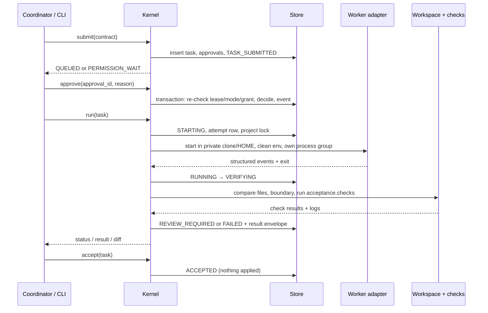

# Architecture

PAR is a small local process plus a SQLite ledger. There is no server, no account system and no
network call in `src/par/`. The design goal is not to be a general agent framework; it is to make
one task's state, permissions and evidence independently verifiable.

## 1. Components

```text
CLI (par …)  ─┐
              ├─►  Kernel  ─►  Store (SQLite ledger, append-only events)
MCP bridge  ─┘      │
                    ├─►  Policy / Contract / States / Approvals
                    ├─►  AttemptRunner ─► Provider adapter ─► vendor CLI
                    │                  └► subprocesses (process group, timeouts)
                    ├─►  Workspace comparison / gitops / validation checks
                    └─►  Manual hand-off packet ─► external GUI tool ─► import
```

| Area | Modules | Responsibility |
|---|---|---|
| Entry points | `cli.py`, `cli_task.py`, `cli_candidate.py`, `cli_handoff.py`, `cli_health.py`, `cli_mcp.py`, `cli_coordinator.py` | Argument parsing, opening one Kernel per command |
| Kernel | `core/kernel.py` plus mixins `submission`, `approvals`, `review`, `recovery`, `reading`, `candidate`, `manual`, `takeover` | Every state change, in one ledger transaction with its event |
| Ledger | `core/store.py`, `core/states.py`, `schemas/` | Append-only events, transition triggers, task/attempt/approval/grant/candidate rows |
| Policy | `core/policy.py`, `core/contract.py`, `core/redact.py` | Path allowlists, protected names, symlink resolution, secret refusal, redaction |
| Execution | `execution/workspace.py`, `gitops.py`, `subprocesses.py`, `validation.py`, `results.py` | Private clone, file comparison, patch creation, argv checks, process groups, result envelope |
| Providers | `providers/base.py`, `manifests.py`, `registry.py`, `codex.py`, `antigravity.py`, `fake.py` | Adapter protocol, static adapter facts, routing, scripted test doubles |
| Context | `context/` | Generic Git context or optional Harness context; manifest and write readiness |
| MCP | `mcp/protocol.py`, `tools.py`, `catalog.py`, `output.py`, `server.py` | JSON-RPC over stdio, 21 tools, argument validation, redacted output |
| Coordination | `coordinators.py`, `core/takeover.py` | Known coordinator registry, lease, takeover packet and confirmation |
| Project registry | `registry.py`, `config.py`, `paths.py` | `projects.toml`, `profiles.toml`, `providers.toml`, data directory safety |

## 2. One attempt, end to end



The worker's own summary is stored as untrusted text. The status is decided only from the Kernel's
file comparison, boundary checks and check exit codes.

## 3. States

```text
DRAFT → READY → QUEUED → STARTING → RUNNING → VERIFYING → REVIEW_REQUIRED → ACCEPTED → CLOSED
                     ↘ PERMISSION_WAIT ↗        ↘ FAILED / INTERRUPTED / RECOVERY_REQUIRED
                     ↘ BLOCKED_NO_WORKER         ↘ AUTH_REQUIRED / RATE_LIMITED / QUOTA_EXHAUSTED
Any allowed state → PAUSED → QUEUED
Any allowed state → CANCEL_REQUESTED → CANCELED
```

The transition table lives in `core/states.py` and is enforced a second time by SQLite triggers, so
an application bug cannot silently invent a transition. Events are append-only; ended attempts are
immutable; each task has a monotonically increasing version.

## 4. Approval and authorization layers

1. **Contract** decides what a task may touch (`risk`, `allowed_paths`, checks).
2. **Project write switch** decides whether a real project may be used for an R2 attempt.
3. **Approval items** stop the task at `PERMISSION_WAIT` for a write permission, worker override,
   base drift or permission retry.
4. **Approval mode + grant** decides who may decide that item.
5. **Coordinator lease** decides whether this bridge is still the coordinator at all; it applies in
   every mode and is re-checked inside the decision transaction.
6. **MCP tool surface** is the smallest layer: health/config/grant operations do not exist there.

Layer 5 is deliberately in the Kernel, not the bridge; see `src/par/core/approvals.py` and
`tests/unit/test_authorization_lease.py`.

## 5. Data boundaries

| Boundary | Rule |
|---|---|
| Real project | Read for Git facts and cloning; never the worker's cwd; never patched automatically |
| Attempt workspace | `tasks/<id>/attempts/<n>/workspace`, one per attempt, private |
| Kernel copies | `scratch/`, `ref/`, `verify/`, `candidates/` under the data directory |
| Data directory | Mode `0700`, files `0600`; the only root `WriteGuard` allows |
| Config | Never contains secrets; vendor logins stay with the vendor CLI |
| Bridge output | Redacted, control characters stripped, clipped, worker text labelled untrusted |

A private clone is isolation of **writes**, not an OS sandbox. Reads and network access depend on the
provider and the host.

## 6. Extension points

- **New native adapter**: add an `AdapterManifest` in `providers/manifests.py`, implement the
  `providers/base.py` protocol, add argv/event parsing tests, a fake CLI for tests, and dated real
  evidence. Do not add a provider that the vendor terms forbid.
- **New context mode**: implement the `context/interface.py` protocol and register it in
  `context/resolver.py`. Generic Git is the default; Harness is optional.
- **New MCP client**: nothing in PAR changes. Configure the client with the printed snippet; the
  protocol and tool schemas are stable. Per-brand evidence is a documentation task, not a code task.
- **New manual tool**: nothing in PAR changes. Use `--to LABEL`; if you want `VERIFIED_MANUAL`,
  record a dated export/import run under `docs/reports/`.

## 7. Reliability and evidence

- Cancellation and timeouts use process groups; the Kernel only signals groups it started and can
  identify.
- Crash recovery settles orphaned attempts without starting a second writer.
- Every attempt keeps its workspace, check logs, `work.patch`, `changes.json` and result envelope
  under the data directory.
- `par candidate create` rebuilds a clean baseline from recorded patches and re-runs checks there.
- Reliability statistics come from the ledger (`ops/reliability_report.py`), not from hand-edited
  numbers in documentation.
